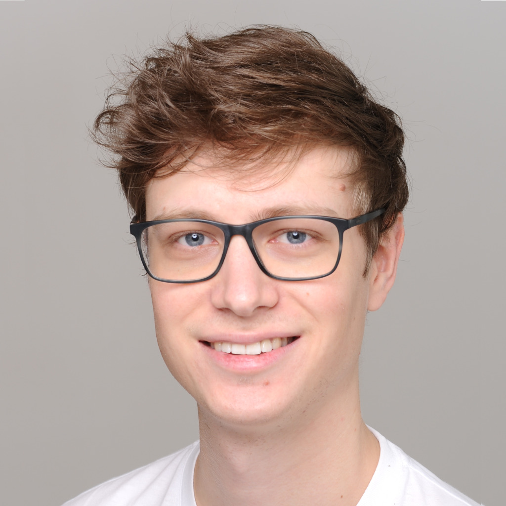

  
  

    <h1>Daniel Schäfer</h1>
    
Head of Software Architecture &amp; EngineeringLead Software Architect, geni:OS genAI at <a href="https://www.semvox.de/">semvox</a> (CARIAD, Volkswagen Group)

    
I lead a Software Architecture &amp; Engineering team in semvox's Applied Research &amp; Development department and own the architecture of geni:OS genAI, the LLM-based assistant platform we build for Volkswagen Group vehicles. I stay hands-on: I design LLM agents, write Python and Java, and build the tooling that makes AI-assisted development reliable.

    

      <a class="button" href="cv_10_2026.pdf">Download CV (PDF)</a>
      <a href="https://www.linkedin.com/in/schaefer-dev/">LinkedIn</a>
      <a href="https://github.com/schaefer-dev">GitHub</a>
      <a href="contact">Contact</a>
    

  

<dl class="facts">
  <dt>Focus</dt>
  <dd>LLM agents and genAI assistant architecture under in-vehicle constraints</dd>
  <dt>Leadership</dt>
  <dd>One of two Software Architecture &amp; Engineering teams, member of the AR&amp;D steering committee</dd>
  <dt>Programming</dt>
  <dd>Python and Java at work. Swift, Kotlin, Rust and C in side and university projects</dd>
  <dt>Education</dt>
  <dd>M.Sc. Computer Science, Saarland University, 2020, grade 1.5</dd>
  <dt>Certification</dt>
  <dd><a href="https://www.certible.com/badge/af8eef7f-af23-42b6-9dbb-fe9661f872f0/">iSAQB Certified Professional for Software Architecture</a></dd>
  <dt>Languages</dt>
  <dd>German (native), English (C2), French (advanced)</dd>
</dl>

<h2 id="career">Career at semvox</h2>
<ol class="timeline">

  <li class="current">
    {{ role.period }}
    

    <h3 class="role-title">{{ role.title }}</h3>
    
{{ role.subtitle }}

    <ul class="tags"><li>{{ t }}</li></ul>
    
{{ role.summary }}

    <ul class="highlights">
      <li>{{ h }}</li>
      
    </ul>
    

      
Full description

      {{ role.details | markdownify }}
    

    

  </li>

</ol>

More detail on individual work projects is on the <a href="projects#work">projects page</a>.

<h2 id="side-projects">Side projects</h2>

I build tools for my own hobbies, mostly birding, cycling, photography and note-taking. A few of them:





<a href="projects#personal">All side projects</a>

<h2 id="education">Education</h2>

  <h3>M.Sc. Computer Science</h3>
  Saarland University, finished October 2020, grade 1.5
  
Thesis on synthesizing implementations from knowledge-aware (KLTL) specifications, supported by the <a href="https://www.react.uni-saarland.de">Reactive Systems Group</a>. <a href="projects#master-thesis">Project details</a>

  <h3>B.Sc. Computer Science</h3>
  Saarland University
  
Thesis on <a href="thesis.pdf">authentication schemes for mobile virtual reality</a>. <a href="projects#university">All university projects</a>

  
Interests during my studies

  
My main interests at university were the fields of embedded systems and operating systems and verification of such systems. However, I intentionally visited a broad selection of courses at university to develop skills in a variety of fields.

  
I very much enjoy the 'challenge' of writing 'low-level' code. In my time as a student this usually resulted in me writing efficient Code in C. Recently I discovered Rust which sparked my interest a couple of times already in the past, mainly because of the strong guarantees (safe) rust code gives by design while getting reasonably close to C performance. This time I actually gave it a serious shot and so far I have been really happy with my decision.

<h2 id="beyond-work">Beyond work</h2>

When I'm not at my desk I'm usually out cycling or travelling with my camera. My <a href="photos">wildlife and landscape photos</a> are on this site. Since 2018 I organize my work with David Allen's "Getting Things Done", and I enjoy tuning my own workflows and tools.

  
More about me

  
I used to be a quite unorganized and spontaneous person, but in late 2018 I read about the principle of "Getting Things Done" by David Allen. Nowadays there is no way I leave the house without a way of putting down my thoughts (usually ends up being phone or laptop) which helps me to organize and plan my week properly. This step forward had a significant impact not only on my overall enjoyment of working but also resulted in me being way more productive in the same amount of time.

  
In 2021 lockdown I found a new passion: cycling and striving for improvements in the sport. During holidays I love traveling to new countries and discovering new places in nature I haven't been at before and <a href="photos">capturing my experiences with my camera</a>.

  
In my free time, I like to keep myself in shape by exercising regularly at home - particularly my back is very thankful for those breaks after hours of sitting in a chair. I would consider myself very passionate about a wide variety of music and audio gear, which also helps me relax after a long day of working if I'm not reading a book on my Kindle. One of my favorite things to do after university is to optimize my workflow, for the tasks I am currently facing. This mainly ends up in me fine-tuning my zsh, tmux, vim or vscode configurations to solve some annoyance I encountered that day.

