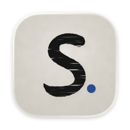
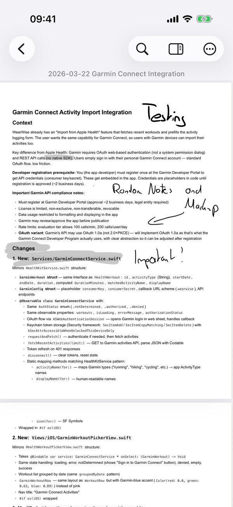
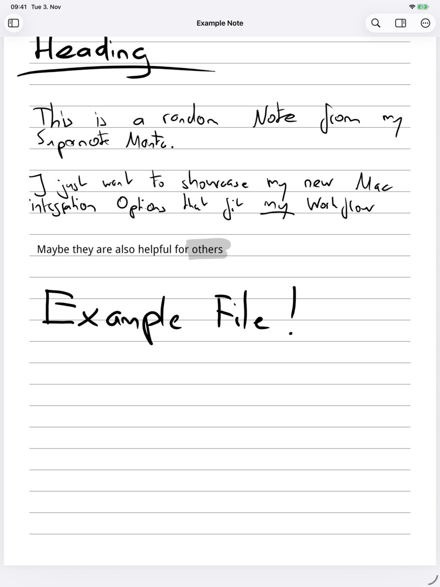

  
  

    <h1>Sumi for Supernote</h1>
    
Your notes, in ink. Read and search the notebooks your Supernote syncs to Dropbox, on iPhone and iPad.

    <!-- Replace with the App Store badge and link once the app is live. -->
    
Coming soon to the App Store.

  

  
  

## What it does

- **Notebooks as they were written.** Sumi renders `.note` notebooks as crisp vector ink from the pen data, and shows `.mark` annotations on their original PDF.
- **Search your handwriting.** Apple's on-device text recognition makes every page searchable, with browser-style find and match stepping.
- **Jump by titles.** The titles you marked on the Supernote become a table of contents, alongside a grid of every page.
- **Your Dropbox library.** Browse your Supernote sync folder, star favorites or single pages, and reopen documents where you left off.
- **Offline when you need it.** Sync All saves readable, searchable copies on your device, optionally in the background on Wi-Fi.
- **Read-only and private.** Sumi asks Dropbox for read-only access and never changes, uploads or deletes your files. There are no accounts, analytics or tracking.
- **Share as PDF.** Export any document as a searchable PDF.

Sumi requires iOS or iPadOS 26. A Mac version that also adds Quick Look previews is available as a [free download on GitHub](https://github.com/schaefer-dev/supernote-viewer).

## Help

<ul class="sumi-links">
  <li><a href="/sumi/support/">Support and frequently asked questions</a></li>
  <li><a href="/sumi/privacy/">Privacy policy</a></li>
  <li>Contact: <a href="mailto:sumi@schaefer-dev.de">sumi@schaefer-dev.de</a></li>
</ul>

Supernote is a trademark of Ratta and is used with permission. Sumi is developed independently by Daniel Schäfer. Dropbox is a trademark of Dropbox, Inc.

