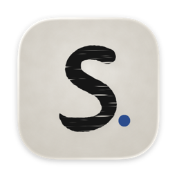
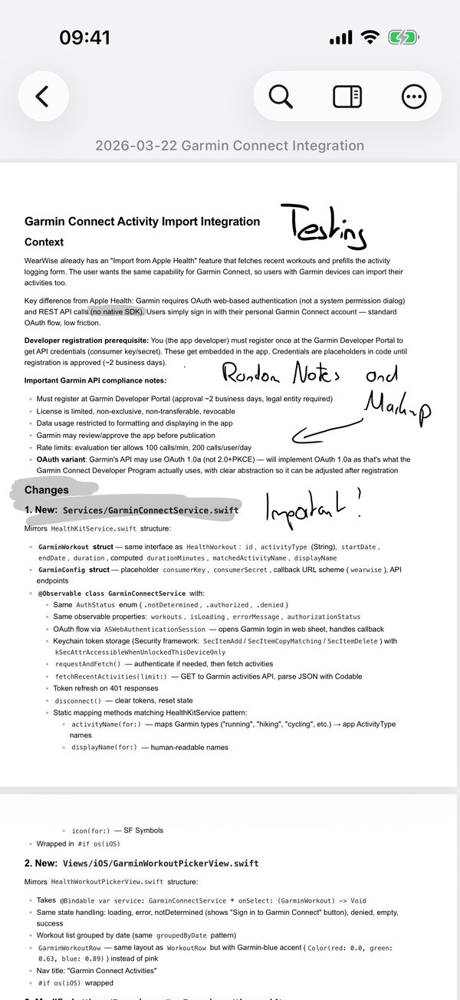
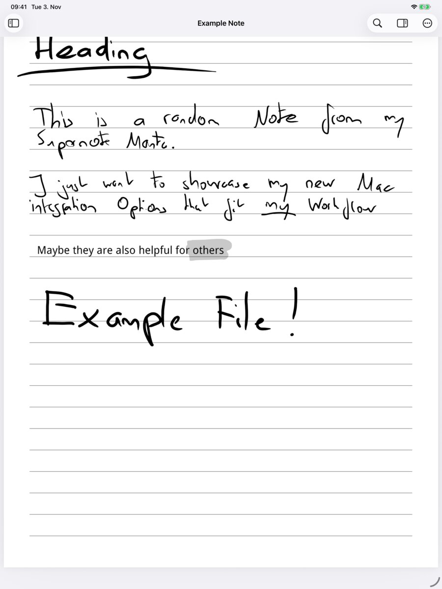

  
  

    <h1>Sumi for Supernote</h1>
    
Your notes, in ink. Read and search the notebooks your Supernote syncs to Dropbox, on iPhone and iPad.

    

    
Free · iPhone &amp; iPad · iOS 26+

  

  
  

## What it does

- Sumi renders `.note` notebooks as crisp vector strokes from the pen data and shows `.mark` annotations on their original PDF.
- Search handwriting on any page using Apple's on-device text recognition. Move between matches as you would in a browser.
- Jump to a title you marked on your Supernote using the table of contents. The page grid shows every page.
- Browse your Supernote sync folder in Dropbox, star documents or individual pages, and reopen documents where you left off.
- Tap **Sync All** to save searchable copies for offline reading. You can also sync in the background over Wi-Fi.
- Sumi asks Dropbox for read-only access and never changes, uploads or deletes your files. There are no accounts, analytics or tracking.
- Export any document as a searchable PDF.

Sumi requires iOS or iPadOS 26. A Mac version that also adds Quick Look previews is available as a [free download on GitHub](https://github.com/schaefer-dev/supernote-viewer).

## Help

<ul class="sumi-links">
  <li><a href="/sumi/support/">Support and frequently asked questions</a></li>
  <li><a href="/sumi/privacy/">Privacy policy</a></li>
  <li>Contact: <a href="mailto:sumi@schaefer-dev.de">sumi@schaefer-dev.de</a></li>
</ul>

Supernote is a trademark of Ratta and is used with permission. Sumi is developed independently by Daniel Schäfer. Dropbox is a trademark of Dropbox, Inc.

